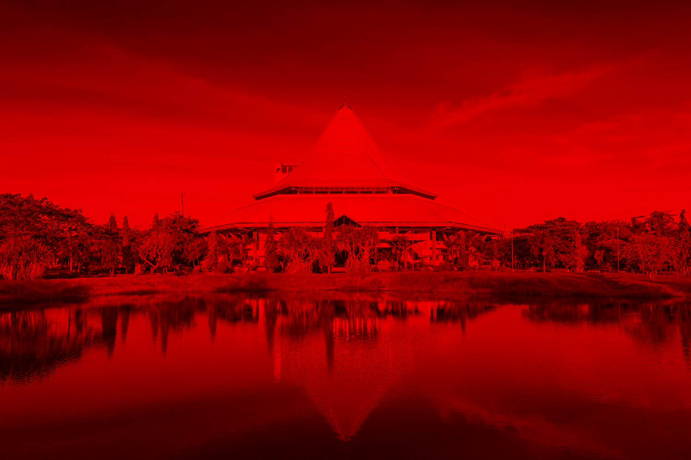
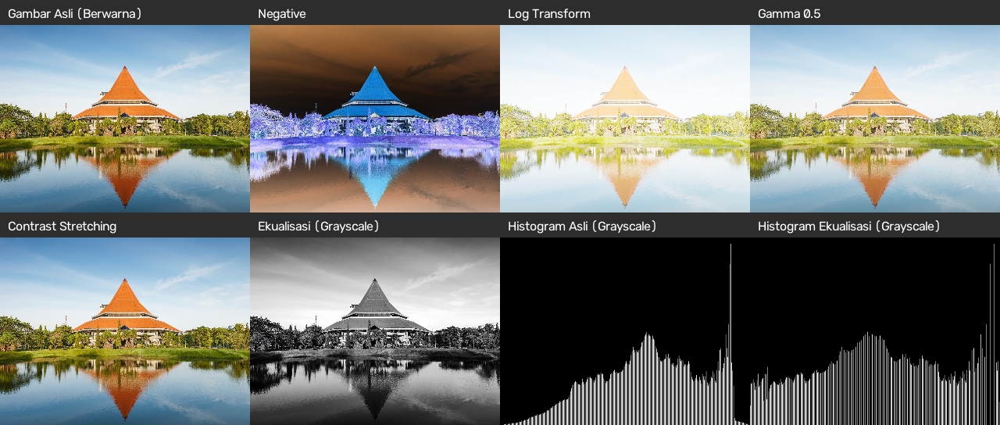
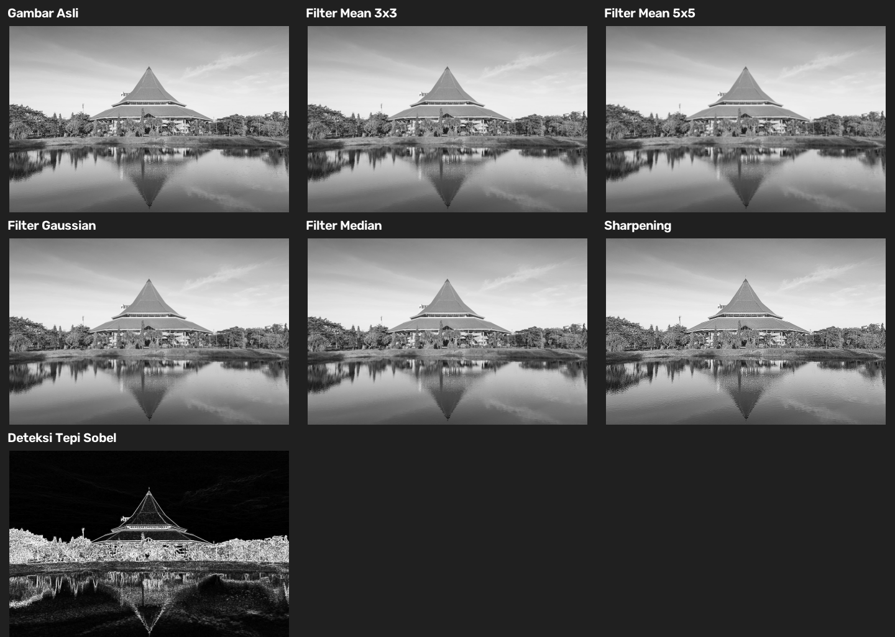
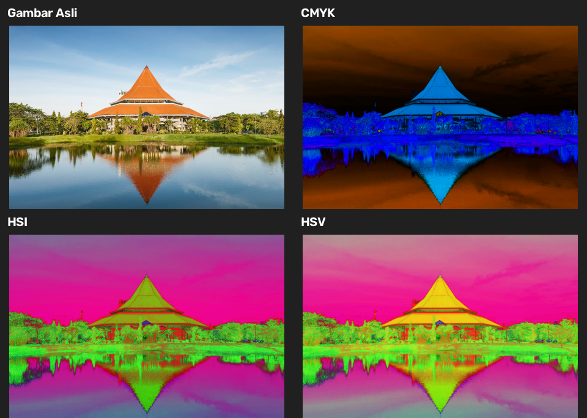
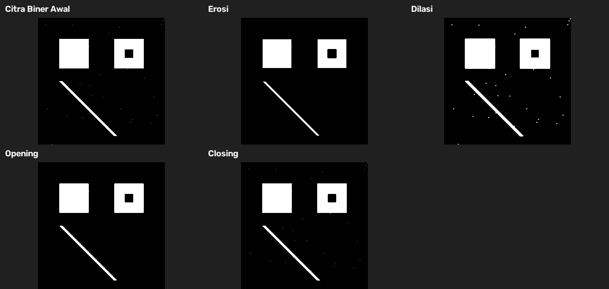

<div align="center">

# 📷 Pengolahan Citra dan Video

**Kumpulan latihan dasar PCV menggunakan Python dan OpenCV**

Eksplorasi transformasi intensitas, filter spasial, model warna, dan morfologi citra.


</div>

## 🗂️ Isi proyek

| File | Topik |
| --- | --- |
| `1-intro.py` | Filter kanal merah pada webcam secara real-time |
| `2-ti-eq.py` | Negative, log, gamma, contrast stretching, dan ekualisasi histogram |
| `3-filter-spasial.py` | Mean, Gaussian, median, sharpening, dan deteksi tepi Sobel |
| `4-model-warna.py` | Konversi warna CMYK, HSI, dan HSV |
| `5-morphology.py` | Erosi, dilasi, opening, dan closing |
| `gambar.jpg` | Gambar masukan untuk program 2–4 |
| `hasil/` | Gambar hasil untuk melihat keluaran tiap program |

## 🚀 Mulai menggunakan

Pasang dependensi:

```bash
python -m pip install opencv-python numpy matplotlib
```

Jalankan perintah dari folder proyek:

```bash
python 1-intro.py
python 2-ti-eq.py
python 3-filter-spasial.py
python 4-model-warna.py
python 5-morphology.py
```

Program `1-intro.py` memerlukan webcam. Tekan **Esc** untuk berhenti. Program 2–5 menampilkan kumpulan hasil dalam satu jendela; tekan sembarang tombol untuk menutupnya.

## 🖼️ Galeri hasil

### 1 · Filter kanal merah

Menampilkan kanal merah dari setiap frame webcam. Gambar di bawah adalah contoh simulasi dengan `gambar.jpg`; saat program berjalan, sumbernya adalah webcam.

<p align="center">
  
</p>

### 2 · Transformasi intensitas & histogram

Perbandingan citra asli, negative, log, gamma 0,5, contrast stretching, grayscale, dan histogram.

<p align="center">
  
</p>

### 3 · Filter spasial

Perbandingan citra grayscale dengan filter mean, Gaussian, median, sharpening, dan Sobel.

<p align="center">
  
</p>

### 4 · Model warna

Visualisasi citra asli dan hasil konversi CMYK, HSI, serta HSV.

<p align="center">
  
</p>

### 5 · Morfologi

Perbandingan citra biner awal dengan hasil erosi, dilasi, opening, dan closing.

<p align="center">
  
</p>

<div align="center">

*Dibuat untuk latihan Pengolahan Citra dan Video.*

</div>
